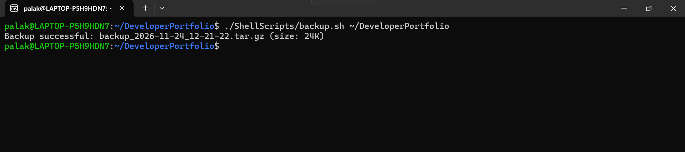
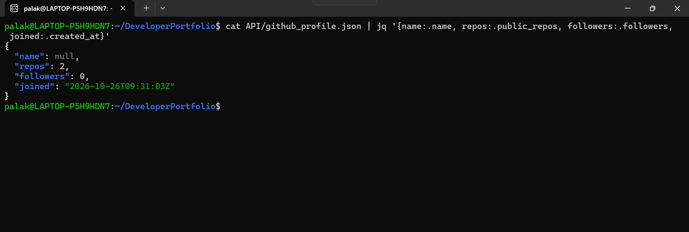
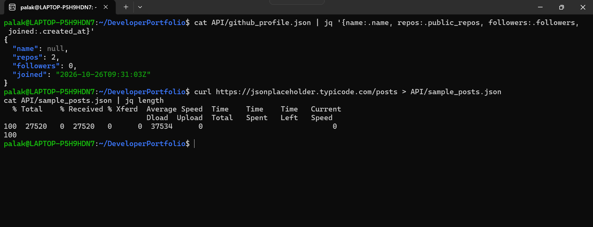
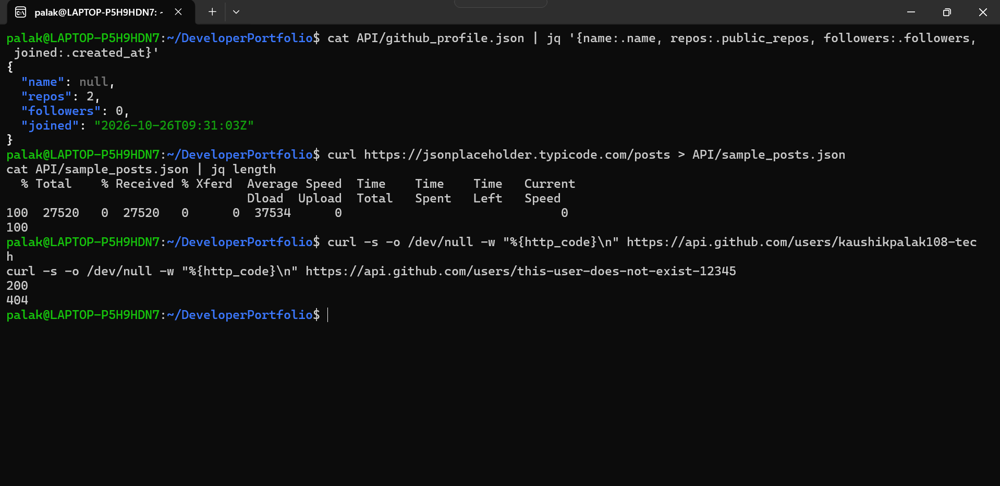

# DeveloperPortfolio

Beginner Developer Ecosystem Portfolio by **Palak** (Roll No. 2601730017), B.Tech CSE AI/ML, 2026, K.R. Mangalam University.

This repository collects my work from four labs: Linux, shell scripting, Git and APIs, and my professional portfolio.

## Links
- GitHub: https://github.com/kaushikpalak108-tech
- LinkedIn: https://www.linkedin.com/in/palak-kaushik-b45546432
- Live website: https://kaushikpalak108-tech.github.io/DeveloperPortfolio

## Sections

### 1. Linux (Linux/)
System profile of my workstation, a manual binary conversion, and Linux command outputs.
- Linux/system_profile.md
- Linux/commands_output.txt

### 2. Shell Scripts (ShellScripts/)
- sysinfo.sh prints a system information report.
- backup.sh creates a timestamped compressed backup of a folder.

### 3. API (API/)
GitHub and JSONPlaceholder API responses fetched with curl and read with jq.
- API/github_profile.json
- API/sample_posts.json
- API/api_summary.md

### 4. Portfolio (Portfolio/)
- Portfolio/resume.pdf
- Portfolio/learning_roadmap.md

## Screenshots
All supporting screenshots are in the Screenshots/ folder.
